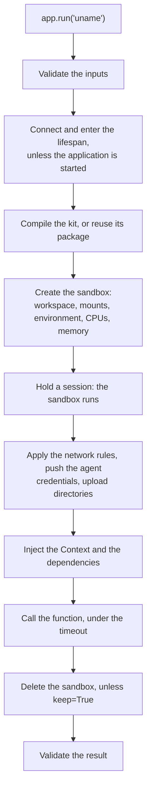

# FastSandbox

FastSandbox is the framework of fastsandbox: an application declares tasks with
decorators, and each call of a task
runs in a throw-away sandbox. The signature of the function drives the rest:
its parameters are the validated inputs, its annotations ask for what is
injected, and its return annotation validates the result. This page builds a
first application and runs it; the next pages take each part in turn.

## A first application

```python title="docs_src/tasks/first_app.py"
--8<-- "docs_src/tasks/first_app.py"
```

- [`FastSandbox("hello")`][fastsandbox.FastSandbox] creates the application.
  Its name prefixes the names of its sandboxes: a run of `uname` creates
  `hello-uname-` followed by a random suffix.
- [`@app.task`][fastsandbox.FastSandbox.task] declares the function as a task
  named after it. Without a `kit`, its sandbox comes from the kit of the
  application, `shell` by default.
- The `ctx: Context` parameter is injected: the [`Context`][fastsandbox.Context]
  of the run gives the sandbox (`ctx.sandbox`), the client, the task and a
  logger. Parameters that are not injected are the inputs of the task.
- [`ctx.sandbox.exec(...)`][fastsandbox.Sandbox.exec] runs a command in the
  sandbox; `check=True` raises
  [`CommandFailedError`][fastsandbox.exceptions.CommandFailedError] on a
  non-zero exit code.
- The return annotation, `str`, validates the result.
- The docstring is the description of the task, shown by `fastsandbox tasks`.

## Running it

From the command line, with the file and the name of the task:

```sh
fastsandbox run docs_src/tasks/first_app.py uname
```

From Python, [`fastsandbox.run(uname)`][fastsandbox.run] runs the task from
synchronous code, as the script does under `__main__`; in async code,
`await app.run("uname")` or `await uname()`. [Running tasks](running.md) covers
every way, [Command line](cli.md) the options the inputs become.

The first run of a kit forges it without the `sbx` CLI, the base kit rebuilt
from its published image, and keeps the package in memory for the next runs of
the process (see [Kits](../client/kits.md)).

## What a run does

Every run goes through the same steps, and the sandbox is deleted at the end
whatever happened, an error or a timeout included:



The function itself runs on the host, in the process of the caller: what runs
in the sandbox is what it asks the sandbox to run, through `ctx.sandbox`.

## Where to go next

| Page | Covers |
|---|---|
| [Tasks](tasks.md) | The options of a task: kit, network, timeout, environment, resources; synchronous tasks |
| [Inputs and outputs](inputs-outputs.md) | How the signature validates the inputs and the result |
| [Agents](agents.md) | Tasks whose sandbox runs a coding agent |
| [Host paths](host-paths.md) | Directories of the host mounted, cloned or copied into the sandbox |
| [Network rules](network.md) | The network rules of the sandbox of a task |
| [Dependencies](dependencies.md) | Injection by annotation and `Depends` |
| [Lifespan and state](lifespan.md) | What runs around the application, and the state it shares |
| [Running tasks](running.md) | The ways to run a task, progress, concurrency and errors |
| [Command line](cli.md) | The `fastsandbox` command |
| [Testing](../guides/testing.md) | Testing an application against the fake daemon |
