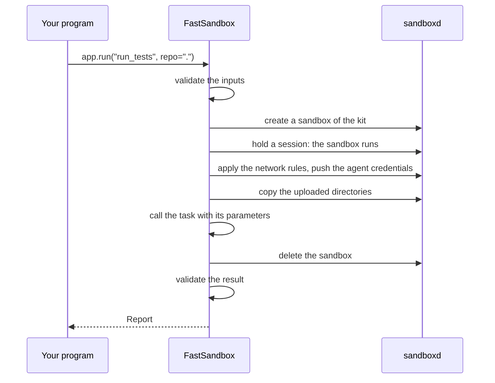

# First steps

Where the [quickstart](quickstart.md) runs an agent, this page goes one level
down, with two programs: one that drives a sandbox with the client, one that
declares a task with FastSandbox and runs it from the command line. Both
create a real sandbox on the daemon of the current user and delete it when
they end.

!!! info "Docker Sandboxes comes first"

    Both programs connect to the socket of the daemon of Docker Sandboxes,
    which must be installed and running for your user: see
    [Installation](installation.md#install-docker-sandboxes).

## A command in a sandbox

```python title="docs_src/client/sandbox_basics.py" linenums="1"
--8<-- "docs_src/client/sandbox_basics.py"
```

- **Line 5**: [`connect()`][fastsandbox.connect] finds the socket of the
  daemon, checks its health and its API version, and returns a
  [`Client`][fastsandbox.Client].
- **Line 6**: [`client.create(kit="shell")`][fastsandbox.Client.create]
  creates a sandbox from the `shell` kit. Used with `async with`, it deletes the
  sandbox when the block ends, also on an error or a cancellation.
  [`sandbox.running()`][fastsandbox.Sandbox.running] holds a session for the
  duration of the block: **a sandbox only stays running while a session is
  held**, so code that works in a sandbox does it inside `running()`.
- **Line 7**: [`exec()`][fastsandbox.Sandbox.exec] runs a command to
  completion. A string is run with `sh -c`, a list is run as is; the result is
  an [`ExecOutput`][fastsandbox.models.ExecOutput] with the exit code and both
  outputs. A non-zero exit code is not an error unless `check=True`.
- **Lines 10 and 11**: files are written and read through the socket.
- **Line 13**: [`deny_hosts()`][fastsandbox.Sandbox.deny_hosts] adds a network
  rule scoped to this sandbox: it goes with it.

Run it:

```sh
uv run python docs_src/client/sandbox_basics.py
```

[`fastsandbox.run()`][fastsandbox.run] runs the coroutine from synchronous
code, with `asyncio.run`.

## A task

FastSandbox turns a function into a task that runs in a throw-away sandbox:

```python title="docs_src/tasks/run_tests.py" linenums="1" hl_lines="8 16-18"
--8<-- "docs_src/tasks/run_tests.py"
```

- **Line 8**: the application, named `ci`, holds the tasks.
- **Line 16**: [`@app.task`][fastsandbox.FastSandbox.task] declares the task
  and its sandbox: the `shell` kit, a network rule that allows `pypi.org`,
  and a deadline of ten minutes.
- **Lines 17 and 18**: the parameters are the inputs of the task.
  [`Context`][fastsandbox.Context] is injected: `ctx.sandbox` is the sandbox of
  the run. `Annotated[Path, Uploaded("/work")]` copies a directory of the host
  into `/work` before the task starts. `command` is an ordinary input with a
  default.
- The inputs are validated against the signature before the sandbox is
  created; the return annotation, a Pydantic model, validates the result.

The command line lists the tasks of a file and their inputs:

```console
$ fastsandbox tasks docs_src/tasks/run_tests.py
run_tests  (task, kit shell)
    Runs the tests of a project in a copy of it.
    --repo  Path, required
    --command  str, default 'make test'
```

and runs one, its inputs given as options; the result is printed as JSON:

```sh
fastsandbox run docs_src/tasks/run_tests.py run_tests --repo . --command "make test"
```

From Python, the same run is `await app.run("run_tests", repo=".")`, or
`app.run_sync(...)` from synchronous code.

## What happens during a run



## Next

- [Agent sandboxes](../agents/repository.md): the decisions of an agent task,
  one page each: its repository, its network, following its work, its tools.
- [The client](../client/index.md): connecting, the life of a sandbox, commands,
  files and everything else the daemon offers.
- [FastSandbox](../framework/index.md): tasks, agents, inputs and outputs,
  dependencies, the command line.
