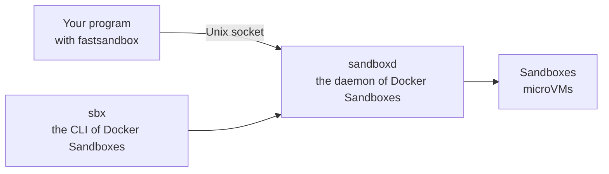

# Installation

fastsandbox is a client. It does not run sandboxes itself: it drives them by
talking to `sandboxd`, the daemon of Docker Sandboxes, through its Unix socket.
Docker Sandboxes is therefore installed first, on the machine where your
programs run, then the package. This page covers both, and how to check that
the package reaches the daemon.



## Requirements

- **Docker Sandboxes**, installed and its daemon running for the current user:
  `sbx version` answers. Linux or macOS.
- **The `sbx` CLI on `PATH`**, installed with Docker Sandboxes: fastsandbox
  uses it to compile a [kit](../client/kits.md) on its first use; later
  sandboxes of the same kit are created through the socket alone.
- **Python 3.12** or newer (3.12, 3.13 and 3.14 are tested);
  `uv python install 3.14` installs one.
- To build from source: a **Rust toolchain** (1.88 or newer) and
  [uv](https://docs.astral.sh/uv/).

## Install Docker Sandboxes

fastsandbox neither ships nor installs Docker Sandboxes: install it with the
[Docker documentation](https://docs.docker.com/ai/sandboxes/), then check, as
the user that will run your programs, that it answers:

```sh
sbx version
```

The daemon runs for that user, and its socket lies in their state directory,
`$XDG_STATE_HOME/sandboxes/sandboxes/sandboxd/sandboxd.sock` or the same path
under `~/.local/state`: that is where fastsandbox looks for it (see
[Where the socket is](../client/index.md#where-the-socket-is)).

!!! warning "Without Docker Sandboxes"

    There is no socket to connect to: [`connect()`][fastsandbox.connect] and
    every task raise
    [`DaemonUnavailableError`][fastsandbox.exceptions.DaemonUnavailableError],
    and `fastsandbox info` reports it.
    Nothing in the package takes the place of the daemon. Only the tests of
    your own code can do without it, against the fake daemon of
    [`fastsandbox.testing`](../guides/testing.md).

## Install the package

=== "uv"

    ```sh
    uv add fastsandbox
    ```

=== "pip"

    ```sh
    pip install fastsandbox
    ```

The wheels are built for CPython 3.12 and later (abi3), on Linux (x86_64 and
aarch64) and macOS (x86_64 and arm64); they hold the native extension, so
nothing is compiled on installation.

## From a checkout

To work on fastsandbox itself, or to run the examples of the repository, build
it from a checkout:

```sh
git clone https://github.com/aartintelligent/fastsandbox
cd fastsandbox
uv sync                 # builds the native extension, installs the package
uv run fastsandbox info # the daemon, its version, the socket
```

`uv sync` builds the extension in debug mode, which is fast to compile; a
change to a Rust file rebuilds it on the next `uv run`. `just wheel` builds the
release wheel of the platform into `dist/`.

## Check the installation

`fastsandbox info` connects to the daemon and prints what it found:

```text
socket       /home/me/.local/state/sandboxes/sandboxes/sandboxd/sandboxd.sock
sbx          v0.54.1 (healthy)
api          0.52.0 (supported 0.52.0 to 0.53.0)
sandboxes    0
kit cache    /home/me/.cache/fastsandbox/kits
```

- **socket**: the socket of the daemon, taken from the `DOCKER_SANDBOXES_API`
  environment variable, otherwise from the state directory of `sbx`
  ([`default_socket_path()`][fastsandbox.default_socket_path]).
- **sbx** and **api**: the version of the daemon and of its API, and the range
  of API versions this release of fastsandbox has been audited on
  ([`SUPPORTED_API`][fastsandbox.SUPPORTED_API]). `connect()` refuses a daemon
  outside that range unless told otherwise; see
  [Connecting](../client/index.md).
- **kit cache**: where compiled kit packages are kept:
  `$FASTSANDBOX_KIT_CACHE`, else `$XDG_CACHE_HOME/fastsandbox/kits`, else
  `~/.cache/fastsandbox/kits`.

## Compile the kits ahead of time

The first sandbox of a kit compiles it with the `sbx` CLI, which can take a few
minutes for an agent kit. To pay that cost once, ahead of a run:

```sh
fastsandbox kits compile shell
fastsandbox kits compile claude
```

The package is compiled again when the daemon runs another `sbx` version.

## Next

- [Quickstart](quickstart.md): a coding agent at work on your repository.
- [First steps](first-steps.md): a command in a sandbox, then a task.
