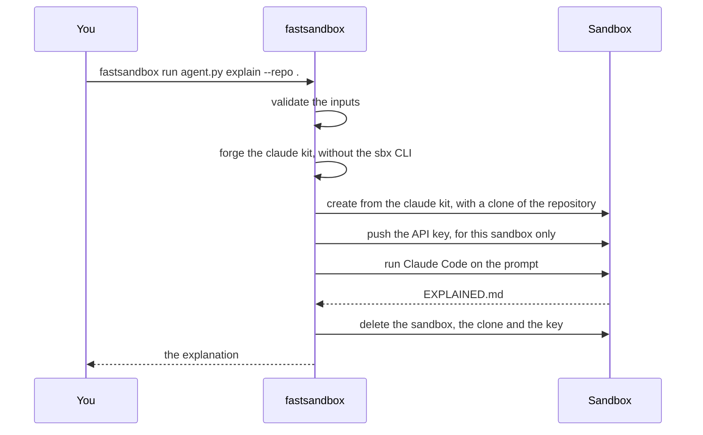

# Quickstart

A coding agent at work on one of your repositories, in a throw-away sandbox, in
five minutes. The agent here is Claude Code; every other agent `sbx` knows
follows the same steps with its own name and key.

!!! tip "Using Claude Code?"

    Install the [fastsandbox plugin](claude-code.md) and run
    `/fastsandbox:new-project`: Claude sets the project up with you, tests
    included.

## 1. Install Docker Sandboxes

fastsandbox runs nothing by itself: it connects to the socket of `sandboxd`,
the daemon of Docker Sandboxes, and asks it for sandboxes. Docker Sandboxes
must be installed on your machine, with its daemon running for your user.
Install it with the [Docker documentation](https://docs.docker.com/ai/sandboxes/),
then check that it answers:

```sh
sbx version
```

You also need:

- **Python 3.12** or newer, and [uv](https://docs.astral.sh/uv/) or pip;
  `uv python install 3.14` installs one.
- **An Anthropic API key**, for Claude Code.

## 2. Install fastsandbox

=== "uv"

    ```sh
    uv add fastsandbox
    ```

=== "pip"

    ```sh
    pip install fastsandbox
    ```

Then check that the package reaches the daemon:

```sh
fastsandbox info
```

It prints the socket it found, the version of `sbx`, and the API versions this
release supports. An error here means Docker Sandboxes is not installed, its
daemon is not running for your user, or it runs a version fastsandbox was not
checked against: see [Troubleshooting](../guides/troubleshooting.md).

## 3. Write the agent task

Create `agent.py` at the root of the repository the agent should work on:

```python title="agent.py" linenums="1" hl_lines="9 10 13-17 19"
--8<-- "docs_src/agents/explain_project.py"
```

- **Line 9**: [`@app.agent("claude")`][fastsandbox.FastSandbox.agent] declares
  a task whose sandbox runs Claude Code, with a deadline of fifteen minutes.
- **Line 10**: the `repo` input is the directory you pass on the command line.
  [`WorkspaceDir(clone=True)`][fastsandbox.WorkspaceDir] gives the sandbox a
  private Git clone of it: the agent may change and commit anything, your
  repository stays as it is. The directory must be a Git repository.
- **Lines 13 to 17**: [`ctx.agent.prompt(...)`][fastsandbox.AgentRunner.prompt]
  runs the agent once on the prompt, unattended, and waits for it to end. The
  agent does not ask before it edits a file or runs a command: the sandbox is
  what makes that safe.
- **Line 19**: the task reads the file the agent wrote, in the clone, and
  returns it.

## 4. Run it

From the root of the repository:

```sh
export ANTHROPIC_API_KEY=sk-ant-...
fastsandbox run agent.py explain --repo .
```

A few minutes later, the explanation of your project is printed. Nothing on
your machine has changed: the clone, the file and the sandbox are gone.

## What just happened



The API key never enters the sandbox: it is pushed as a secret of that sandbox
alone, and the proxy of the sandbox adds it to the requests Claude Code sends
to Anthropic; the agent only sees a placeholder. The sandbox is deleted
whatever happens, an error or a timeout included.

## Try another agent

The task reads a file rather than the output of the agent, so it works with any
agent: change `"claude"` to `"codex"`, export its key, and run again: its kit
is forged on the first run.

```sh
export OPENAI_API_KEY=sk-...
fastsandbox run agent.py explain --repo .
```

The agents and the keys each one reads are listed on the
[agents page](../framework/agents.md#the-agents).

## Next

<div class="grid cards" markdown>

-   :lucide-git-branch:{ .lg .middle } __Let it change your code__

    ---

    Workspace, clone or copy: how the agent gets the code, and how its work
    comes back, checked by your tests.

    [:lucide-arrow-right: Give it a repository](../agents/repository.md)

-   :lucide-shield:{ .lg .middle } __Decide what it can reach__

    ---

    Network rules for its sandbox alone, and the hosts it reached, read after
    the run.

    [:lucide-arrow-right: Control its network](../agents/network.md)

-   :lucide-activity:{ .lg .middle } __Watch it work__

    ---

    Its events as they come, progress for the caller, and the sandbox kept to
    look inside.

    [:lucide-arrow-right: Follow its work](../agents/follow.md)

-   :lucide-users:{ .lg .middle } __Run several agents__

    ---

    Two agents on the same issue, side by side, and the patch that passes the
    tests.

    [:lucide-arrow-right: Run several agents](../agents/several.md)

</div>
