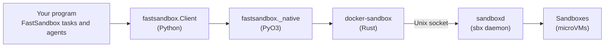

# Design

fastsandbox is a Python package over a Rust library. This page records the
layers and the decisions that shape them, each in a few sentences, with a link
to the page that shows it in use.

## Layers

The framework is written on the public API of the client; the client validates
every payload with the models of `fastsandbox.models` and raises the errors of
`fastsandbox.exceptions`; the native extension only bridges the Rust library:
handles, awaitables on a shared tokio runtime, streams and errors.

## Decisions

**One source of truth for the daemon.** Every route, field and behavior of the
daemon comes from `docker-sandbox`, which audits the socket API version by
version. A new route goes into the crate first, then here; the package never
talks to the socket on its own.

**A bridge without logic.** The native extension has one frozen class per
handle of the crate and turns every async method into an awaitable. Helpers,
defaults and conveniences are Python, where they can be read, typed and
tested.

**Payloads in the shape of the crate.** The models use the field names of the
crate, accept the daemon's own names as aliases, and keep the fields they do not
know, so that a newer daemon loses nothing on the way.
See the [models](../reference/models.md).

**Errors classified once.** The extension raises the classes of
`fastsandbox.exceptions`, built by name from the errors of the crate, with
their details as typed attributes; a program catches `NotFoundError` or
`SandboxTimeoutError` without importing the extension or reading a message.
See [Errors](../client/errors.md).

**The API version is checked.** The socket API is private and changes with
`sbx` releases. `connect()` compares the API version of the daemon with the
range this release was checked against, and refuses one outside it unless told
otherwise. See [The API version](../client/index.md#the-api-version).

**A sandbox runs while a session is held.** The daemon stops a sandbox about
30 seconds after its last session closes, so code that works in one does it inside
`async with sandbox.running()`, and a task holds a session for its whole run.
See [Sessions](../client/sandboxes.md#sessions).

**Kits compiled once.** The daemon cannot resolve a kit by itself: the `sbx`
CLI does. A kit package captures what the CLI sends for a kit, once, and every
later sandbox of that kit is created through the socket alone.
See [Kits](../client/kits.md).

**The task runs on the host.** The function of a task runs in the process of
its caller; what runs in the sandbox is what it asks the sandbox to run. Its
sandbox is created before the call and deleted after it, whatever happened.
See [What a run does](../framework/index.md#what-a-run-does).

**Credentials pushed, never read.** The socket never reads the secrets stored
with `sbx secret set`. The credentials of an agent are read from the
environment of the host and pushed to the sandbox of the run only, where the
proxy injects them. See [Agents](../framework/agents.md#credentials).
